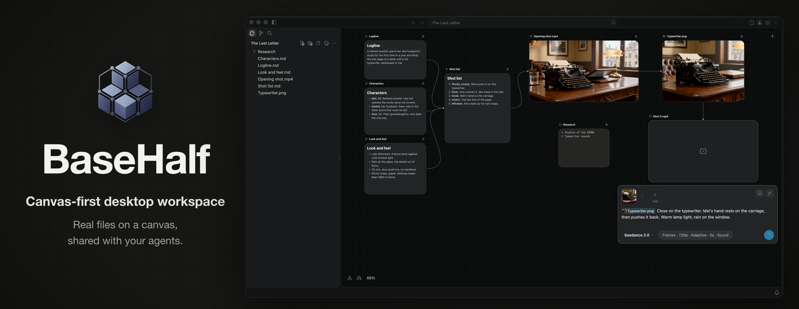

  

### Hi, I am Jerry

I am building **[BaseHalf](https://github.com/Pointa-Labs/basehalf)**, an open-source desktop workspace where a folder opens as a canvas.

Notes, images, videos, and PDFs stay ordinary files in that folder. On the canvas they are cards you can arrange and connect, and the connections are saved in the files. Claude Code, Codex, and other agents work in the same folder and read the same connections. There is no BaseHalf account and no cloud database: the folder is the project.

### How It Works

- **Canvas**: a folder in BaseHalf. Each file in it is a card, and each subfolder opens its own canvas.
- **Card**: one file, such as a note, an image, a video, or a PDF. Notes are edited right on their cards.
- **Connection**: `A → B` means A's context flows into B. It is saved in B: a note lists what flows into it in its `upstream` frontmatter, so an agent that reads the note sees it too.
- **Agent Area**: Claude Code, Codex, or a terminal next to the canvas, in the same folder. A `basehalf` skill tells them where descriptions and connections are, and what you selected.
- **Image and video cards**: generated with your own API keys, from providers such as ByteDance, Kling, Google, Runway, and OpenAI. The cards connected to one are its inputs, and the file it makes becomes the card.

### Build Log

  

